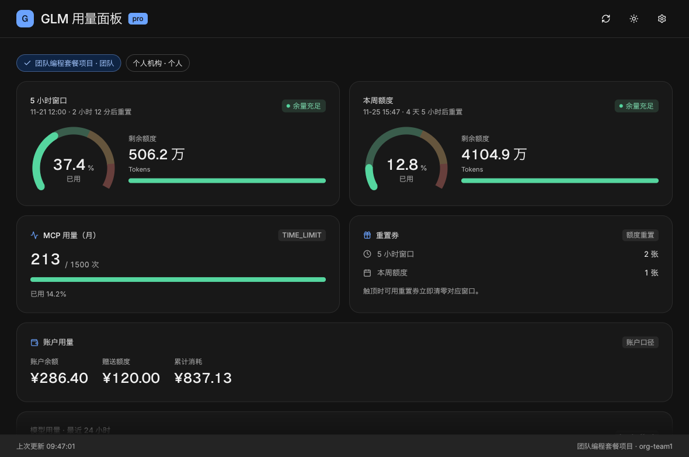
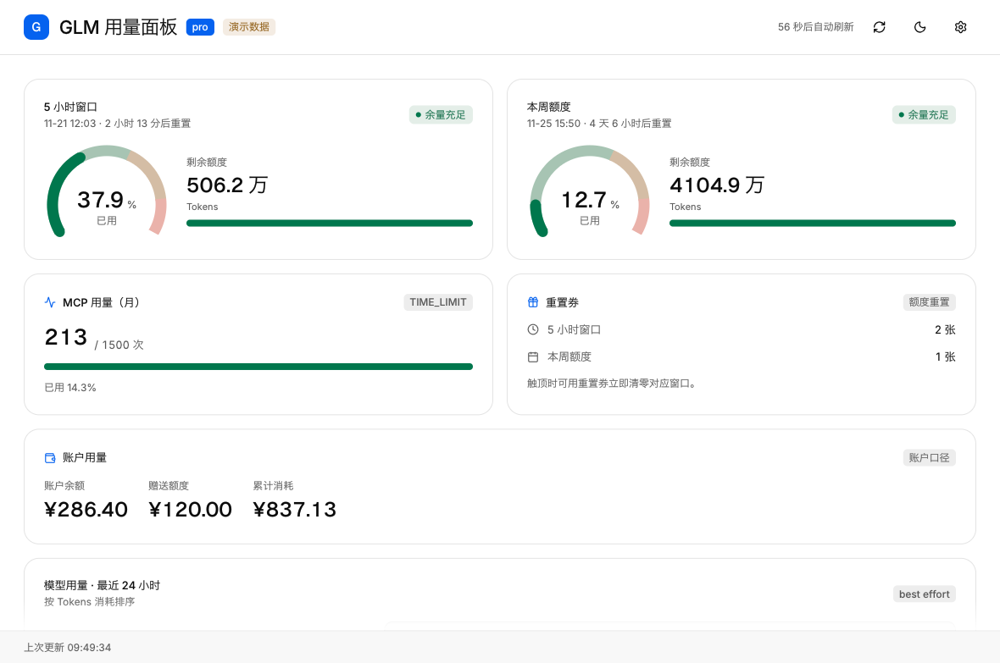
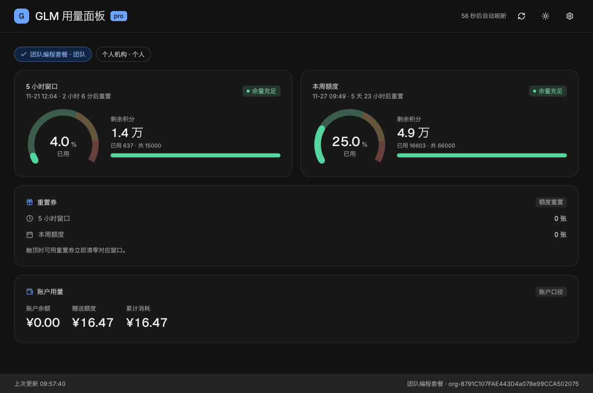
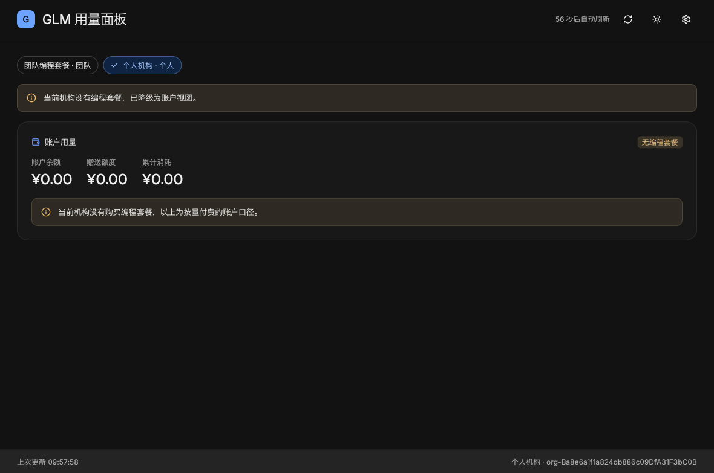

# GLM 用量面板 · glm-usage-panel

<p align="center">
  
  
</p>

一个用 [CUI](https://github.com/yappologistic/CUI)（纯 C 绘制的立即模式 UI 库）做的
**智谱 GLM / BigModel 套餐用量桌面面板**。与之前给
[有道听力宝 E6](https://github.com/weibaohui/youdao-tinglibao-e6) MiniApp、
Metalio 墨水屏、Kindle KRocker 做的 GLM 用量查询同源的接口契约 —— 这是第一个桌面窗口版本，
**已于 2026-11-21 用真实凭据跑通**（团队套餐 + 个人机构双视图）。

<p align="center">
  
  
</p>

原生窗口（macOS / Windows / Linux，OpenGL 渲染、软件渲染兜底），整包约 1 MB，
无 WebView、无 Electron、无运行时依赖。**同一份 C 代码也可以编译到浏览器（WASM）** —— CUI 自带这条路径。

## 功能

- **两个额度窗口**：5 小时窗口 / 本周额度（以 `nextResetTime` 更早者为 5 小时窗）——环形仪表（绿 → 黄 → 红分档）、剩余量、重置时间（UTC+8 + 相对时间）。
  兼容两种真实返回形态：旧版 `TOKENS_LIMIT`+`CREDIT_LIMIT`（剩余按 Tokens 标注，ISO 时间串）；
  2026-11 实测新版两个窗口均为 `CREDIT_LIMIT`（剩余按积分标注，`nextResetTime` 为毫秒时间戳，
  另有 `unit`/`number`（3/5=5 小时窗、6/1=周窗）与 `currentValue`/`usage`（已用/总量））
- **MCP 用量**（`TIME_LIMIT`）：当月请求数 / 上限
- **重置券**：5 小时 / 本周窗口的可用张数
- **账户口径**：余额 / 赠送额度 / 累计消耗；无编程套餐的机构自动降级为账户视图
  （接口返回 code 500「当前用户不存在coding plan」按预期处理，不是错误）
- **模型用量**（best effort）：最近 24 小时各模型 Tokens/请求数，环形图 + 表格
- **多机构/项目一键切换**：胶囊行点击即切，选中项持久化；每次请求都带
  `Bigmodel-Organization` + `Bigmodel-Project` 头
- **两种认证方式，都在应用内配置**（密码框，不落日志）：
  - **API Key**（`<id>.<secret>`）：每次请求在本地**现算** HS256 JWT
    （`{"alg":"HS256","sign_type":"SIGN"}` + `{"api_key","exp","timestamp"}`）。
    服务端同时校验 JWT 的时间戳新鲜度，现算的 JWT 永远不会过期；
  - **现成 Token**：Coding Plan 的 `ANTHROPIC_AUTH_TOKEN` 或任何现成 JWT，直接作为 `Authorization` 发送。
- **网页 JWT 自动发现机构**（可选、一次性）：粘贴 bigmodel.cn 网页端 JWT，
  一键拉取账号下全部机构/项目并写入配置，随后 JWT 即从输入框清除
- 每 15–3600 秒自动刷新（可关）、手动刷新、⌘R；深浅主题一键切换，可持久化
- 纯 C99 + 自带加密（SHA-256 / HMAC / base64url），加密实现对拍过 22 条向量
  （含填充边界、UTF-8、代理对），见 `tools/crypto_selftest.py`

## 构建

需要 CMake ≥ 3.14、C99 编译器。macOS 自带 libcurl；Linux 装一份即可
（`sudo apt install libcurl4-openssl-dev`）。没有 libcurl 也能构建，但只出演示模式。

```sh
cmake -S . -B build -DCMAKE_BUILD_TYPE=Release
cmake --build build -j
./build/glm-usage-panel
```

首次运行会进入引导页，点「打开设置」填 API Key 或 Token 即可。配置保存在
`~/.config/glm-usage-panel/config.json`（Windows 为 `%APPDATA%\glm-usage-panel\config.json`），
也可以手工编辑：

```json
{
  "auth_mode": 0,
  "api_key": "xxxxxxxx.yyyyyyyy",
  "base_url": "https://open.bigmodel.cn",
  "web_url": "https://bigmodel.cn",
  "refresh_seconds": 60,
  "auto_refresh": true,
  "dark": true,
  "selected": 0,
  "contexts": [
    { "name": "团队编程套餐项目", "org": "org-XXXX", "project": "proj-YYYY", "project_type": 2 },
    { "name": "个人机构", "org": "org-ZZZZ", "project": "proj-WWWW", "project_type": 1 }
  ]
}
```

国际站用户把 `base_url` 换成 `https://api.z.ai` 即可。机构/项目 ID 的抓法：
登录 [bigmodel.cn](https://bigmodel.cn) → F12 → Network → `getCustomerInfo`
响应里的 `organizations[].organizationId` 与 `projects[].projectId`；
或者直接在设置里粘网页 JWT 点「发现机构」自动填。

### 环境变量

| 变量 | 作用 |
| :--- | :--- |
| `GLM_CONFIG` | 配置文件路径覆盖（测试/多账号用） |
| `CUI_THEME=light/dark` | 强制主题（优先于配置） |
| `CUI_SCALE` | 缩放覆盖 |
| `GLM_UI_OPEN_SETTINGS` | 启动即打开设置（调试用） |

## 本地测试（不打真实 API）

```sh
python3 tools/mock_server.py 8791          # 假的 BigModel usage API，校验 JWT 新鲜度
python3 tools/crypto_selftest.py           # C 加密实现 vs Python hashlib，22 条向量
GLM_CONFIG=/tmp/your-config.json ./build/glm-usage-panel
```

`tools/mock_server.py` 复刻了真实接口的全部坑：三段式 JWT + 新鲜度校验（过期回 code 1003）、
机构头缺失时返回 `data:{}` 的静默空数据（`org-decoy`）、个人机构 code 500 等。
`tests/discovery_test.c` 会打这个 mock，覆盖机构发现与静默空数据两条路径。

无凭据或无网络时可以 `./build/glm-usage-panel --demo` 跑演示数据（README 截图即由此而来）。

## 接口契约

与墨水屏 / Kindle / E6 版本同源，均真机双向验证过：

| 用途 | 端点 | 鉴权 |
| :--- | :--- | :--- |
| 查额度 | `GET https://open.bigmodel.cn/api/monitor/usage/quota/limit?type=2` | API 现算 JWT + `Bigmodel-Organization` + `Bigmodel-Project` |
| 查重置券 | `GET https://open.bigmodel.cn/api/biz/customer-package-reset/list?targetType=TEAM` | 同上 |
| 团队账户消耗 | `GET https://open.bigmodel.cn/api/biz/account/query-org-owner-account-report` | 同上 |
| 个人账户消耗 | `GET https://open.bigmodel.cn/api/biz/account/query-customer-account-report` | 同上 |
| 发现机构/项目 | `GET https://bigmodel.cn/api/biz/customer/getCustomerInfo` | `Authorization: Bearer <网页端JWT>`（注意带 Bearer） |
| 模型用量 | `GET https://open.bigmodel.cn/api/monitor/usage/model-usage?startTime=..&endTime=..` | API 现算 JWT |

三个必须记住的坑（详见 E6 项目的 [GLM_USAGE.md](https://github.com/weibaohui/youdao-tinglibao-e6/blob/main/docs/GLM_USAGE.md)）：

1. **API Key 和网页端 JWT 是两套东西，不能互换**——额度接口只认 API Key 现算的 HS256 JWT；
   `getCustomerInfo` 只认网页端 JWT；API Key 原文直接当 Authorization 会报 `APIKey not allow access`。
2. **额度接口必须带机构/项目头**，否则 HTTP 200 但 `data:{}`（静默空数据，看起来像没套餐）。
3. **JWT 的 timestamp 有新鲜度校验**——同一份 JWT 放 26 分钟再打会回 code 1003，
   所以本应用每次请求都现签。

## 工程结构

```text
src/
├── main.c          # 入口，--demo 演示模式
├── ui.c            # 全部界面：顶栏 / 胶囊 / 窗口卡片 / 设置抽屉 / 状态栏
├── glm.c / glm.h   # 配置持久化、libcurl 客户端、响应解析、后台线程
├── crypto.c / .h   # SHA-256 / HMAC-SHA256 / base64url / JWT 现签（无依赖）
└── minijson.c / .h # 极小 JSON 解析器（arena，转义/\uXXXX/代理对全支持）
tools/
├── mock_server.py  # 假 BigModel usage API（含全部坑位）
└── crypto_selftest.py
tests/
└── discovery_test.c
```

## 行为说明

- **关闭窗口即退出**。CUI（v1.4.0）暂无系统托盘/拦截关闭的 API（`cui_status_bar_*` 是窗口内底栏，不是系统托盘），
  所以不做"最小化到托盘"；自动刷新只在窗口存活期间工作。
- 界面中文依赖系统 CJK 字体做回退（macOS Hiragino/Heiti、Linux Noto/WQY、Windows 雅黑），
  运行时自动探测，找不到会提示且不崩溃。构建时 CUI 通过 FetchContent 拉取固定 tag（v1.4.0）。

## 安全

- API Key 只存在本机配置文件；界面密码框显示，不进日志、不进仓库
- 网页 JWT 一次性使用，发现成功即从输入框清除
- 仓库、mock、测试里没有任何真实凭据

## License

MIT
